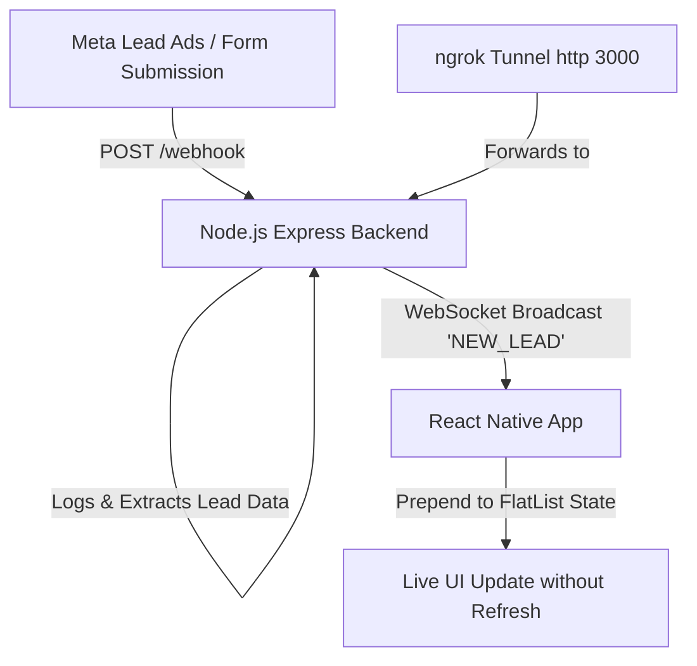

# Real-Time Lead Updates Application

A complete real-time lead tracking solution designed for Meta (Facebook/Instagram) Lead Generation webhooks. Built with a **Node.js Express & WebSocket backend** and a **React Native frontend** inside a single unified repository.

---

## 🏗 System Architecture & Workflow



1. **Meta Webhook Verification (`GET /webhook`)**: Verifies `hub.mode`, `hub.verify_token`, and returns `hub.challenge`.
2. **Meta Webhook Ingestion (`POST /webhook`)**: Receives `leadgen` events from Meta, extracts lead parameters, and logs payload details.
3. **WebSocket Real-Time Broadcast**: Instantly broadcasts `NEW_LEAD` payloads to all connected mobile/web React Native clients over WebSocket.
4. **React Native UI**: Connects to the WebSocket server, dynamically prepends incoming leads into a custom styled `FlatList`, and displays real-time connection status indicators.

---

## 📁 Repository Structure

```text
.
├── backend/                  # Node.js + Express + WebSockets Server
│   ├── package.json          # Backend dependencies (express, ws, body-parser, cors)
│   └── server.js             # Webhook endpoints & WebSocket logic
├── LeadApp/                  # React Native Mobile & Web Application
│   ├── package.json          # Frontend dependencies & scripts
│   ├── App.tsx               # Main React Native component (FlatList, WebSocket listener, UI)
│   └── app.json              # Expo configuration
└── README.md                 # Complete documentation & setup instructions
```

---

## 🚀 Quick Start Guide

### Prerequisites
- **Node.js** (v18 or higher)
- **npm** or **yarn**
- **ngrok** (optional for live Meta Webhook tunneling)

---

### Step 1: Start the Backend Service

1. Open a terminal and navigate to the `backend` folder:
   ```bash
   cd backend
   ```
2. Install dependencies (if not already installed):
   ```bash
   npm install
   ```
3. Run the backend server:
   ```bash
   node server.js
   ```
   > The server will start on `http://localhost:3000` with WebSocket support at `ws://localhost:3000`.

---

### Step 2: Set Up Ngrok Tunnel for Meta Webhooks

To connect your local Express server to Meta's live developer webhooks, expose port `3000` via ngrok:

1. Open a separate terminal and run:
   ```bash
   ngrok http 3000
   ```
2. Copy the generated HTTPS forwarding URL (e.g. `https://a1b2-34-56-78-90.ngrok-free.app`).

---

### Step 3: Configure Meta Webhooks (Page / Leadgen)

1. Go to the [Meta Developer Dashboard](https://developers.facebook.com/).
2. Select your app and go to **Webhooks** under Products.
3. Select **Page** from the dropdown and click **Subscribe to this object**.
4. Configure the subscription fields:
   - **Callback URL**: `https://<YOUR_NGROK_SUBDOMAIN>.ngrok-free.app/webhook`
   - **Verify Token**: `my_secret_webhook_token` (default defined in `server.js`)
5. Click **Verify and Save**. Meta will issue a `GET` request to verify your token.
6. Subscribe to the `leadgen` field.

---

### Step 4: Run the React Native App (`LeadApp`)

1. Open a new terminal and navigate to the `LeadApp` directory:
   ```bash
   cd LeadApp
   ```
2. Install dependencies:
   ```bash
   npm install
   ```
3. Start the application:
   ```bash
   # Run on Web browser
   npm run web

   # Or start Expo CLI to open on Android/iOS emulator or Expo Go app
   npx expo start
   ```

> **Note on WebSocket IP address**:
> - Running on **Browser / iOS Simulator**: WebSocket connects to `ws://localhost:3000`.
> - Running on **Android Emulator**: Set WebSocket URL to `ws://10.0.2.2:3000`.
> - Running on **Physical Mobile Device**: Set WebSocket URL to `ws://<YOUR_COMPUTER_LOCAL_IP>:3000`.

---

## 🧪 Testing & Verification

### Method A: Test via Built-in App Trigger (Easiest)
In the React Native app interface, click the **"Simulate Lead"** button at the header. It will send a sample payload to the backend server, which will instantly broadcast it back to the `FlatList`.

### Method B: Test via cURL / Postman (API Test Endpoint)
Run this command in any terminal while the server is running:

```bash
curl -X POST http://localhost:3000/api/test-lead \
  -H "Content-Type: application/json" \
  -d '{"name": "Sarah Jenkins", "email": "sarah.j@example.com", "phone": "+1 555-0144", "service": "Enterprise Tier"}'
```

### Method C: Meta Payload Simulation
Simulate a full Meta Page Leadgen Webhook payload:

```bash
curl -X POST http://localhost:3000/webhook \
  -H "Content-Type: application/json" \
  -d '{
    "object": "page",
    "entry": [{
      "id": "1092837465",
      "time": 1700000000,
      "changes": [{
        "value": {
          "created_time": 1700000000,
          "leadgen_id": "493820192847102",
          "page_id": "1092837465",
          "form_id": "FORM_META_PROMO_2026",
          "adgroup_id": "ADG_9988",
          "ad_id": "AD_1122"
        },
        "field": "leadgen"
      }]
    }]
  }'
```

---

## 🔑 Key Features Implemented

- **Meta Webhook Verification**: Full compliance with Meta's `hub.mode`, `hub.verify_token`, and `hub.challenge` handshake specifications.
- **Instant Real-Time Sync**: Instant zero-latency updates powered by native WebSockets.
- **Dynamic FlatList UI**: New leads are prepended dynamically to the top of the feed with visual badges and state updates.
- **Connection Status Indicator**: Visual indicator showing server connectivity state (`Connected`, `Reconnecting`, `Disconnected`).
- **Clean Responsive Styling**: Modern UI built with sleek cards, badges, and dark/light contrast formatting.
